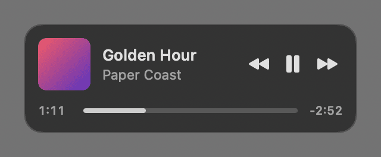
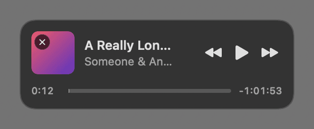

# Encore

A small now-playing card for Apple Music. Hover over Music in the Dock and a card appears above the icon with the cover, title, artist, a timeline you can scrub, and back / play-pause / skip.

<p> </p>

- Drag the card by its background and let go with **⌘** held to pin it (it stays on screen like picture-in-picture; hover shows ✕ to close). Let go without ⌘ to dismiss it.
- Encore never launches Music; it only talks to it while it's already running.
- No menu bar icon. Open Encore again from Applications to quit it, turn Open at Login on/off, or jump to the Accessibility settings.

## Requirements

- macOS 26 or later, with the built-in Music app.
- **Accessibility** permission (System Settings › Privacy & Security › Accessibility), so Encore can tell when the pointer is over Music's Dock icon. macOS asks on first launch.
- **Automation › Music** permission, asked the first time Encore reads what's playing.

Because builds are signed ad hoc (not with a paid Apple Developer ID), macOS treats every rebuild as a new app: after reinstalling, switch Encore off and on again in Accessibility.

## Install

**Download:** get [Encore.zip](https://github.com/byaydenrx/Encore/releases/latest/download/Encore.zip) from the [latest release](https://github.com/byaydenrx/Encore/releases/latest) (Apple silicon and Intel, macOS 26 or later).

1. Double-click `Encore.zip` to unzip it, and drag **Encore** into your Applications folder.
2. Open it. Because the app isn't notarized by Apple, macOS says it can't verify it: click **Done**.
3. Open System Settings › Privacy & Security, scroll down to “Encore was blocked”, click **Open Anyway** and confirm. You only do this once.
4. Encore asks for **Accessibility** access: turn it on in System Settings › Privacy & Security › Accessibility. It also asks once to control Music.

**Or build it yourself** (no Gatekeeper prompt), with Swift 6 from the Xcode Command Line Tools (`xcode-select --install`) or Xcode:

```sh
git clone https://github.com/byaydenrx/Encore.git
cd Encore
./install.sh
```

`install.sh` builds Encore, copies it to `~/Applications` and opens it. `./build.sh` only builds `build/Encore.app`.

## Data

None besides its preferences. Log: `~/Library/Logs/Encore.log` (trimmed to the newest 256 KB once it passes 1 MB).

## Test modes

`Encore --state` (prints what Music is playing and the artwork size), `--snapshot <dir>` (card PNGs with stand-in tracks), `--preview` (live card in the middle of the screen).

## License

MIT — see [LICENSE](LICENSE).
